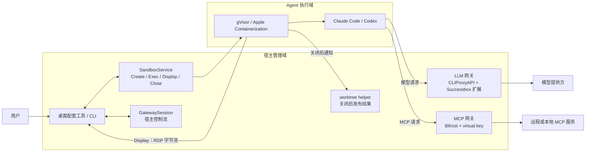

# Successbox

[](https://github.com/MeteorsLiu/successbox/actions/workflows/go.yml)
[](https://github.com/MeteorsLiu/successbox/actions/workflows/platform.yml)
[](https://github.com/MeteorsLiu/successbox/actions/workflows/gateways.yml)
[](https://github.com/MeteorsLiu/successbox/actions/workflows/apple.yml)


**让 Claude Code 和 Codex 在熟悉的工作流中获得隔离保护。**

Successbox 是 Agent 的配套运行时：它在宿主机上管理受控的沙箱、网关和结果保存，让用户继续使用原来的 Agent、项目和配置。它不是另一个 Agent，也不是通用虚拟机管理器。Agent 通过统一的 gRPC 生命周期运行，桌面场景通过同一条 `Display` 流传输 RDP 画面与输入。

项目目前处于持续集成阶段。下面先说明产品和架构，再给出已经实现的能力、明确的边界以及本地运行入口。

## 先看这些

| 主题 | 入口 |
| --- | --- |
| 产品方向 | [初版产品设计 #1](https://github.com/MeteorsLiu/successbox/issues/1) · [桌面配套工具 #16](https://github.com/MeteorsLiu/successbox/issues/16) |
| 总体架构 | [Agent 沙箱、LLM 网关与 Bifrost MCP 网关 #2](https://github.com/MeteorsLiu/successbox/issues/2) |
| 沙箱协议 | [Create、Exec、Display、Close #3](https://github.com/MeteorsLiu/successbox/issues/3) · [API 契约](api/README.md) |
| 文件与成果 | [worktree 设计 #7](https://github.com/MeteorsLiu/successbox/issues/7) · [runtime 边界](runtime/README.md) |
| 网络与网关 | [网络和网关生命周期 #12](https://github.com/MeteorsLiu/successbox/issues/12) · [网关运行说明](gateways/README.md) |
| MCP 与敏感字段 | [MCP 安装和敏感值交互 #14](https://github.com/MeteorsLiu/successbox/issues/14) · [桌面集成说明](desktop/README.md) |
| macOS 启动 | [Apple Containerization 承载 gVisor #24](https://github.com/MeteorsLiu/successbox/issues/24) |

Issue 是设计决策和待验证边界的索引，不代表其中所有目标都已经实现。当前行为以协议文件、源码和各模块 README 为准。

## 产品流程

用户不需要学习新的 Agent 命令，也不需要管理 guest IP、挂载点或 VM。典型流程是：

1. 用户在宿主端选择 Claude Code 或 Codex，并保留自己的项目和配置环境。
2. Successbox 创建一个沙箱，通过受控文件视图、进程树和资源限制启动 Agent。
3. Agent 的模型请求和 MCP 调用经过宿主网关；真实上游凭据留在可信管理域，沙箱只看到受限身份或占位符。
4. 用户可以在宿主 UI 中处理 MCP 安装审批和敏感值输入，这些交互不通过 Agent 对话传递。
5. Agent 结束后，Linux Git 仓库结果可以注册为 detached worktree；沙箱关闭才进入发布流程。

Successbox 的产品原则是：宿主原配置不直接回写，Agent 不能凭自报的 sandbox ID 获得管理权限，关闭沙箱和发布结果是同一个生命周期里的不同阶段。

## 架构



模块职责保持单向：沙箱运行时只负责执行隔离和生命周期，网关负责协议、上游连接和授权，worktree helper 负责 Git 仓库准备与发布，前端负责用户选择和可信交互。控制流和模型/MCP 数据流是不同的权限域；宿主控制端口不会直接暴露给 guest。

## 已实现能力与边界

| 能力 | 当前状态 |
| --- | --- |
| 沙箱生命周期 | Go 后端提供 `Create`、`Exec`、`Display`、`Close`；控制协议是本地 Unix socket 上的 gRPC。 |
| Linux 后端 | 基于 gVisor `runsc`，支持命令执行、TTY、资源限制和 RDP 转发。 |
| macOS 后端 | Apple Silicon 上使用 Containerization / Virtualization.framework；也可以启动承载 Linux gVisor 的 VM。 |
| 桌面传输 | `Display` 传递 RDP 原始字节，键盘和鼠标输入走同一条双向流；断开 viewer 不等于关闭沙箱。 |
| 网关 | 宿主侧可以启动 CLIProxyAPI 和 Bifrost，并通过 `GatewaySession` 管理 MCP 安装、敏感值和取消操作。 |
| Git 结果 | Linux `--worktrees` 模式在首次访问仓库时准备私有副本，`Close` 后注册 detached worktree，失败时保留结果。 |
| 非 Git 文件 | 独立目录保存和目录语义分类尚未完成；普通写入仍属于一次性临时层。 |
| Agent 配置 | 配置适配、完整用户文件继承、macOS worktree 发布和完整桌面 E2E 仍需单独验证。 |

网关客户端联调已经覆盖真实 CLIProxyAPI、Bifrost、Claude Code 和 Codex 的部分路径，但这不等于完整的“宿主文件环境 → 沙箱 → 模型请求 → MCP → 关闭发布”产品验收。README 中的验证记录会明确区分协议测试、宿主联调和真实桌面验证。

## 快速开始

### 构建

Go 模块需要 Go 1.27.1。Swift 包需要 Swift 6.2 及 macOS 26；依赖版本锁定在 `Package.swift` 和 `Package.resolved`。

```sh
make go       # 构建 sbx 客户端和 Linux 后端
make apple    # 构建并签名 Apple 后端
make check    # Go race tests
```

### Linux 后端

准备 gVisor `runsc` 及其 release 文件后启动服务：

```sh
./bin/successbox-gvisor-linux-amd64 \
  --socket /absolute/path/successbox/control.sock \
  --state /absolute/path/successbox/state \
  --runsc /absolute/path/to/runsc
```

默认网络为 `none`。网关数据入口和宿主控制端口不是同一个地址；不要把管理端口放进 guest。

启用 Linux Git worktree 流程时，再构建 runtime helper 并传入 `--worktrees`：

```sh
go build -o bin/successbox-gvisor ./cmd/successbox-gvisor
CGO_ENABLED=0 go -C runtime build -o ../bin/worktree-runtime/runsc ./cmd/runsc
CGO_ENABLED=0 go -C runtime build -o ../bin/worktree-runtime/gvisor-bin/gvisor_sentry ./cmd/sentry
CGO_ENABLED=0 go -C runtime build -o ../bin/worktree-runtime/worktrees ./cmd/worktrees
sudo ./bin/successbox-gvisor \
  --socket /var/lib/successbox/control.sock \
  --state /var/lib/successbox \
  --runsc "$(pwd)/bin/worktree-runtime/runsc" \
  --worktrees "$(pwd)/bin/worktree-runtime/worktrees"
```

### macOS Apple 后端

准备 ARM64 Linux kernel 和包含 `vminitd`、`vmexec` 的 `initfs.ext4`：

```sh
./bin/successbox-apple \
  --socket /absolute/path/successbox/control.sock \
  --state /absolute/path/successbox/state \
  --kernel /absolute/path/to/vmlinux-arm64 \
  --initfs /absolute/path/to/initfs.ext4
```

macOS gVisor 模式需要额外提供 Linux rootfs 和 runtime 目录。它运行的是 Linux 程序，不会把 macOS Mach-O 应用放进 guest；宿主项目映射和 worktree 回传也不应从“VM 能启动”推断为已完成。完整命令和图形验证见 [Apple 后端说明](#macos-上的-gvisor) 与测试脚本。

#### macOS 上的 gVisor

```sh
make apple
mkdir -p bin/linux-runtime/gvisor-bin
CGO_ENABLED=0 GOOS=linux GOARCH=arm64 go build -o bin/linux-runtime/successbox-gvisor ./cmd/successbox-gvisor
CGO_ENABLED=0 GOOS=linux GOARCH=arm64 go -C runtime build -o ../bin/linux-runtime/runsc ./cmd/runsc
CGO_ENABLED=0 GOOS=linux GOARCH=arm64 go -C runtime build -o ../bin/linux-runtime/gvisor-bin/gvisor_sentry ./cmd/sentry

./bin/successbox-apple \
  --socket /absolute/path/successbox/control.sock \
  --state /absolute/path/successbox/state \
  --kernel /absolute/path/to/vmlinux-arm64 \
  --initfs /absolute/path/to/initfs.ext4 \
  --linux-rootfs /absolute/path/to/linux-rootfs \
  --runtime-directory "$(pwd)/bin/linux-runtime"
```

共享的 Linux rootfs 和 runtime 目录是只读的；VM 使用独立的稀疏 ext4 可写层。默认资源是 4 个 vCPU、1 GiB 外层容器内存和 128 MiB VM 开销。资源上限不是实测占用量。

## 协议示例

Create 请求使用 protobuf 字段名：

```json
{
  "rootfs": "/absolute/path/to/linux-rootfs",
  "env": ["TERM=xterm-256color"],
  "workingDir": "/",
  "desktop": false
}
```

```sh
./bin/sbx --socket /absolute/path/successbox/control.sock create box.json
./bin/sbx --socket /absolute/path/successbox/control.sock exec --sandbox SANDBOX_ID --tty -- /bin/sh
./bin/sbx --socket /absolute/path/successbox/control.sock close SANDBOX_ID
```

RPC 的最小生命周期是：

| RPC | 数据方向 |
| --- | --- |
| `Create` | rootfs、环境、初始进程和资源选项 → sandbox ID |
| `Exec` | 启动命令、stdin、resize、signal → stdout/stderr 和最终退出码 |
| `Display` | 连接 sandbox → RDP 字节和键鼠输入 |
| `Close` | sandbox ID → 停止进程并清理运行时状态 |

协议细节、认证元数据和 GatewaySession 双向消息见 [api/README.md](api/README.md)。

## 桌面应用

桌面应用位于 `desktop/`，使用 Electron、React 和 TypeScript。它默认连接真实的 `GatewaySession`，支持 MCP 安装审批、敏感值弹窗、已保存密钥列表、删除和断线重连；尚未把账号管理、全局沙箱开关、持久运行记录和全部 Agent 启动路径接成完整产品流程。

```sh
cd desktop
npm install
npm start
npm run typecheck
npm run lint
npm run package
```

真实模式需要先在宿主启动 `sbx gateways` 并配置控制 token。模拟界面必须显式设置 `SUCCESSBOX_DEMO=1`；真实服务未连接时不会静默返回模拟成功。更多配置和安全边界见 [desktop/README.md](desktop/README.md)。

## 验证

```sh
make check
go test -race ./...
```

CI 分别覆盖 Go race tests、Linux amd64/arm64 platform runtime、macOS Apple backend 和宿主 gateway tests。原生 VM 和 RDP 检查需要目标机器上的 kernel、initfs、rootfs、RDP 客户端及桌面依赖；编译通过或协议夹具通过，不能替代图形登录、鼠标键盘和关闭发布的完整验收。

主要入口：

| 边界 | 代码 |
| --- | --- |
| 公开协议 | `api/sandbox/v1/sandbox.proto`、`api/gateway/v1/gateway.proto` |
| Linux 生命周期 | `cmd/successbox-gvisor/` |
| Apple 启动 | `apple/Sources/SuccessboxApple/Main.swift` |
| 网关宿主服务 | `cmd/sbx/`、`gateways/` |
| gVisor 拦截与 worktree | `runtime/internal/platform/`、`runtime/cmd/worktrees/` |
| Electron 前端 | `desktop/src/main/`、`desktop/src/preload/`、`desktop/src/renderer/` |
| 原生集成检查 | `testdata/apple-gvisor.py`、`testdata/apple-gvisor-display.py`、`testdata/gvisor-worktrees.sh` |

## 设计原则

- 宿主原文件不直接回写；结果通过既有 tmpfs、私有仓库和 Close 发布流程处理。
- Agent 使用受限网关身份，真实上游 API key 和 OAuth 留在宿主网关。
- `Display` 是 RDP 双向字节流，不是截图轮询或 JSON 鼠标事件。
- 关闭 viewer、关闭 sandbox、取消网关 pending 操作和撤销凭据是不同动作。
- 尚未接通的账号、配置继承、非 Git 成果导出和完整桌面流程会明确显示为缺口，不返回模拟成功。
