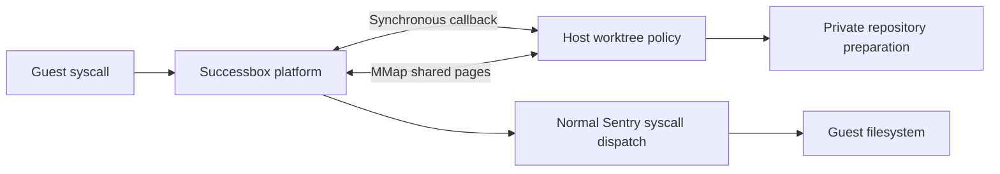

# Successbox runtime

The `successbox` platform wraps gVisor's systrap platform and intercepts syscalls before Sentry dispatches them. Both the runsc launcher and Sentry register the platform. This Go module is pinned to the same gVisor revision as `xgo-dev/sandbox`: `d1e35511e5a41ee5c2afc522d2f9b0c27cf8d382`.

## Boundaries



`internal/platform` owns the generic syscall callback, guest memory and argument/result replacement. It has no Git or worktree branches and does not install filesystem mounts. `internal/intercept` contains the private wire records. `cmd/worktrees` owns repository discovery, path replacement and publication. Its callback transport is separate from its path policy. The public Successbox RPC protocol and sandboxexec are unchanged.

Runsc's existing `--platform_device_path` donates a private Unix packet connection to Sentry. The socket is never installed into the guest FD table. While a syscall is stopped, the host callback can read strings, resolve guest paths, allocate temporary memory, modify arguments or supply a result. Guest VFS lookups use the task's credentials and actual cwd/directory FDs; waits use Sentry's supervisor context.

## Build

On Linux amd64 or arm64, from this directory:

```sh
CGO_ENABLED=0 go build -o bin/runsc ./cmd/runsc
CGO_ENABLED=0 go build -o bin/gvisor-bin/gvisor_sentry ./cmd/sentry
CGO_ENABLED=0 go build -o bin/worktrees ./cmd/worktrees
go test -race ./internal/platform ./cmd/worktrees
```

Keep `runsc` and `gvisor-bin/gvisor_sentry` together. Both must be built from this module. Without a platform device, the wrapper delegates execution to systrap and records syscall counts. The device check accepts runsc's absent-device representation (`FD=-1`) as well as nil.

## Temporary syscall memory

`syscallMemory.mmap(address, size)` follows the existing sandbox implementation:

- Address zero allocates zeroed guest pages. A nonzero address copies guest input into independent pages; a partial read returns its readable prefix and errno.
- Sentry donates the backing descriptors to the trusted host callback. The callback maps those pages with `MAP_SHARED`; editing its byte slice edits the temporary guest pages, without modifying the original input.
- The policy places the guest address into the syscall argument. A host pointer must never be placed there.
- Host aliases are unmapped before the callback returns. Guest mappings survive until syscall completion. Restarted or undispatched allocations are retained until task exit; an extra memory-manager reference protects them across `execve`.

Cleanup wraps the pinned syscall table once, before tasks and tracing start. No gVisor dependency source or C bridge is modified. The adapted memory implementation's license is in `third_party/sandbox-LICENSE`.

## Worktree policy

The caller starts `worktrees --socket SOCKET --bundle OCI_BUNDLE --state RESULTS`, then launches runsc with `--platform=successbox --platform_device_path=SOCKET`. The caller mounts `RESULTS` writable before startup and includes that mount in the policy OCI spec, hides the control socket/runtime state from the guest, and applies a disposable overlay to the host filesystem. The integration test uses `--overlay2=root:dir=OVERLAY` and a single writable results bind. When sharing `/`, first create a recursive bind of it at a separate rootfs directory in a private mount namespace; the test does this without copying system files. Other host binds must remain read-only or receive their own disposable layer; switching an arbitrary configuration from `all` to `root` would expose writable binds.

On first access to a repository, the policy prepares a private working directory, preserving staged, unstaged, untracked and ignored files. Working files use reflinks when supported and copies otherwise. Git objects and metadata are independent of the source. Concurrent first accesses create one copy. This is lazy per repository, not a whole-system snapshot or per-file lazy copying.

For example, `/home/me/project/file` becomes `RESULTS/repo-123/worktree/file`. The callback writes the replacement pathname into MMap pages and changes the syscall argument. Sentry then performs its ordinary permission checks and filesystem operation. The platform never mounts a repository or handles Git data. Relative paths, directory FDs and symlink traversal are resolved through the same policy; `getcwd` translates the private path back to its original name.

Stop the sandbox before terminating the policy process with SIGTERM. It registers each completed private directory as a detached worktree, imports object data and preserves the index without changing the original working files or branch. Guest-controlled configuration and hooks are not executed by host Git during publication. Private metadata is retained alongside the result as `worktree.git`; `repositories.json` records source and result paths. Publication failures retain results and return an error.

The Linux service starts and stops the policy with Create and Close when `--worktrees` is configured. It mounts the current sandbox’s results at `/run/successbox-results`; the policy maps that guest path to its retained host directory. Preparation/publication workers use the guest UID, GID and supplementary groups and require a rootful Linux caller. Read-only mounts are not promoted. Runtime state must be outside source repositories. Copying is not an atomic snapshot against simultaneous host edits. Submodules, nested repository publication, constrained `openat2` remapping (returns `EOPNOTSUPP`), changing guest roots/mount namespaces and checkpoint/restore are not covered. Non-Git writes remain in the disposable overlay.

## Integration tests

The Platform workflow builds and tests on native Linux amd64 and arm64. The worktree integration test uses the existing sandboxexec API with the Linux host root; it does not use Docker:

```sh
CGO_ENABLED=0 go build -o bin/worktree-test ./testdata/worktrees
sudo "$(pwd)/bin/worktree-test" /tmp/successbox-worktrees "$(pwd)/bin/worktrees" "$(pwd)/bin/runsc"
```

The fixture runs as guest UID 0 and 1000 and checks dirty/staged/untracked contents, guest Git, rename/delete operations, nofollow/exclusive opens, symlink traversal, directory FD access, `getcwd`, concurrent first access and preservation of host files. Its writable results bind is deliberately separate from the disposable root overlay.

The MMap integration fixture installs a test policy with `-tags successbox_mmap_probe`. Build both runtime executables with that tag and build `testdata/memory` plus `testdata/memory-guest`. Its policy replaces fixture paths and buffers and checks allocation, aliases, partial reads, concurrent calls, cleanup, restart and exec behavior. The ordinary runtime does not include that fixture policy.
